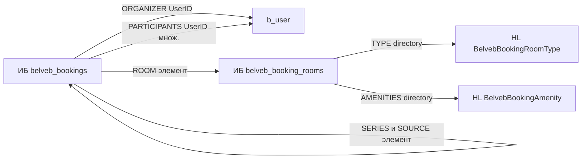

# Структура данных модуля бронирования

Администратор управляет объектами и бронями в инфоблоках. Highload-блоки только справочники: тип переговорной и оборудование. Сотрудники — пользователи сайта, привязанные свойствами инфоблока броней. Структуру создаёт и снимает `installDB()` / `unInstallDB()` модуля `belveb.booking`. Страницы пока читают `FixtureCatalog`; чтение из инфоблоков — отдельный шаг. Компоненты экранов — в [`components.md`](components.md).

## Схема связей

## Откуда взяты поля

| Макет | Данные на экране | Где хранится |
|-------|------------------|--------------|
| `410:546` список | «Переговорная 1», «Большой зал Правления», фото, Wifi / ВКС / Проектор / Экран / USB-C, «до 10 человек», «6 этаж»; фильтры Этаж, Тип переговорной | инфоблок комнат: `LABEL`, `NAME`, `PREVIEW_PICTURE`, `AMENITIES`, `CAPACITY`, `FLOOR`, `TYPE` |
| `866:343` детальная | шкала 08:00–19:00, слоты с темой и организатором, границы 13:00–14:50 | `WORK_FROM` / `WORK_TO` / `SLOT_STEP` комнаты; элементы `belveb_bookings` этой комнаты за день |
| `415:65` мои брони | статус, число людей, время, дата, организатор, повтор, участники | `STATUS`, `DATE_FROM` / `DATE_TO`, `ORGANIZER`, `PARTICIPANTS`, `REPEAT`, `REPEAT_FROM` |
| `868:3483` подтверждение | Тема, Участники, Повтор, Комментарий | `NAME`, `PARTICIPANTS`, `REPEAT`, `DETAIL_TEXT` |
| `1114:541` редактирование | «6/10» участников | `CAPACITY` комнаты и число `ORGANIZER` + `PARTICIPANTS` |
| `1114:923` повторное | «Данные перенесены из встречи 06.09.2026» | свойство `SOURCE` |

## Тип инфоблока

| Параметр | Значение |
|----------|----------|
| ID | `belveb_booking` |
| Название | «Бронирование» |
| Разделы | не используются |

Оба инфоблока привязаны ко всем активным сайтам. На стенде модуль ищет их по `API_CODE`, не по числовому ID.

## Инфоблок объектов `belveb_booking_rooms`

| Параметр | Значение |
|----------|----------|
| `API_CODE` | `bookingRooms` |
| Название | «Переговорные» |
| Детальная страница | `#SITE_DIR#booking/#CODE#/` |

Администратор добавляет комнаты, меняет фото, этаж, вместимость и активность в карточке элемента.

### Стандартные поля

| Поле | Назначение |
|------|------------|
| `NAME` | Название: «Большой зал Правления» |
| `CODE` | ЧПУ детальной: `bolshoy-zal-pravleniya` |
| `ACTIVE` | Комната доступна для бронирования |
| `SORT` | Порядок в списке |
| `PREVIEW_PICTURE` | Фото карточки |
| `DETAIL_TEXT` | Описание; на макетах не показывается |

### Свойства

| Код | Тип | Множ. | Обяз. | Назначение |
|-----|-----|-------|-------|------------|
| `LABEL` | строка `S` | нет | да | Подпись над названием: «Переговорная 1» |
| `FLOOR` | число `N` | нет | да | Этаж |
| `CAPACITY` | число `N` | нет | да | Вместимость, «до 10 человек» |
| `TYPE` | `S:directory` → `belveb_booking_room_type` | нет | да | Тип переговорной |
| `AMENITIES` | `S:directory` → `belveb_booking_amenity` | да | нет | Оборудование |
| `WORK_FROM` | строка `S` | нет | нет | Начало рабочего дня, `HH:MM`; пусто — опция модуля |
| `WORK_TO` | строка `S` | нет | нет | Конец рабочего дня, `HH:MM`; пусто — опция модуля |
| `SLOT_STEP` | число `N` | нет | нет | Шаг сетки в минутах; пусто — опция модуля |

Шаг по умолчанию — 10 минут. Рабочие часы по умолчанию — 08:00–20:00. Значение `S:directory` — это `UF_XML_ID` записи справочника.

## Инфоблок броней `belveb_bookings`

| Параметр | Значение |
|----------|----------|
| `API_CODE` | `bookings` |
| Название | «Бронирования» |
| Публичный URL | нет, элемент только в админке |

`NAME` — тема встречи. `DETAIL_TEXT` — описание. `ACTIVE_FROM` и `ACTIVE_TO` не хранят интервал встречи: штатная проверка активности скрыла бы будущие брони.

Один элемент — один экземпляр встречи. Повтор раскрывается в отдельные элементы с общим `SERIES`, чтобы пересечение искалось по комнате и датам.

### Свойства

| Код | Тип | Множ. | Обяз. | Назначение |
|-----|-----|-------|-------|------------|
| `ROOM` | элемент `belveb_booking_rooms` | нет | да | Комната; администратор перепривязывает в карточке |
| `ORGANIZER` | `S:UserID` | нет | да | Организатор, выбор пользователя |
| `PARTICIPANTS` | `S:UserID` | да | нет | Участники без организатора |
| `DATE_FROM` | `S:DateTime` | нет | да | Начало |
| `DATE_TO` | `S:DateTime` | нет | да | Окончание |
| `STATUS` | список | нет | да | `booked` Забронировано, `completed` Завершена, `cancelled` Отменена |
| `REPEAT` | список | нет | нет | `none`, `daily`, `weekly`, `monthly` |
| `REPEAT_FROM` | `S:Date` | нет | нет | Первая дата серии |
| `REPEAT_UNTIL` | `S:Date` | нет | нет | Последняя дата серии |
| `SERIES` | элемент этого же инфоблока | нет | нет | Корень серии; пусто у одиночной брони и у корня |
| `SOURCE` | элемент этого же инфоблока | нет | нет | Бронь, из которой сделано «Забронировать снова» |
| `CANCELLED_AT` | `S:DateTime` | нет | нет | Когда отменена |
| `CANCELLED_BY` | `S:UserID` | нет | нет | Кто отменил |

Список участников на экране — организатор плюс `PARTICIPANTS`. Вместимость сравнивается с этим числом и `CAPACITY` комнаты. Активная бронь — `STATUS = booked`. Пересечение: у той же `ROOM` нет другой брони `booked`, у которой `DATE_FROM < новое DATE_TO` и `DATE_TO > новое DATE_FROM`.

Статус и повтор — списки инфоблока, не справочники: набор закрыт кодом домена, администратор меняет значение на элементе.

## Highload-справочники

Имя HL-блока (`NAME`) — ключ поиска на стенде. Поля создаёт `\CUserTypeEntity`, `ENTITY_ID = HLBLOCK_<id>`.

### `BelvebBookingRoomType`

Таблица `belveb_booking_room_type`. Справочник свойства `TYPE`.

| Поле | Тип | Назначение |
|------|-----|------------|
| `UF_NAME` | string, обяз. | «Зал Правления», «Переговорная» |
| `UF_XML_ID` | string, обяз. | `board`, `meeting` |
| `UF_SORT` | integer, по умолчанию 500 | Порядок в фильтре |

### `BelvebBookingAmenity`

Таблица `belveb_booking_amenity`. Справочник свойства `AMENITIES`.

| Поле | Тип | Назначение |
|------|-----|------------|
| `UF_NAME` | string, обяз. | «Wifi», «Система видеоконференцсвязи», «Проектор», «Экран», «USB-C» |
| `UF_XML_ID` | string, обяз. | `wifi`, `vcs`, `projector`, `screen`, `usb_c` |
| `UF_ICON` | file | SVG-иконка; файл ставит администратор |
| `UF_SORT` | integer | Порядок тегов |

`installDB()` добавляет эти записи, если `UF_XML_ID` ещё нет. Комнаты и брони установщик не создаёт.

HL-блоки броней, серий и участников не используются.

## Пользователи

Организатор, участники и автор отмены — `b_user` через свойство `S:UserID`. В редакции «Стандарт» нет типа `employee`; `UserID` даёт в админке выбор пользователя и позволяет перепривязать бронь. ФИО читается через `\Bitrix\Main\UserTable`.

Права инфоблоков: чтение группе «все пользователи» (2), запись группе администраторов (1). Создавать бронь на сайте может авторизованный пользователь. Менять и отменять чужую — администратор инфоблока.

## Установка и снятие

`DoInstall()` регистрирует модуль, вызывает `installDB()`, затем копирует файлы. `DoUninstall()` сначала показывает `install/unstep1.php` с флажком «Сохранить данные».

Порядок `installDB()`:

1. HL-справочники, их поля, записи `UF_XML_ID`.
2. Тип инфоблока `belveb_booking`.
3. Инфоблок комнат и свойства.
4. Инфоблок броней и свойства. `SERIES` и `SOURCE` ссылаются на него же.

Повторный запуск не создаёт дубли: тип по `ID`, инфоблок по `CODE`, свойство по `CODE`, HL по `NAME`, поле по `FIELD_NAME`, запись справочника по `UF_XML_ID`.

`unInstallDB()` без сохранения удаляет инфоблок броней, инфоблок комнат, тип и оба HL вместе с таблицами. С флажком сохранения таблицы не трогает. Код — `lib/Install/HighloadInstaller.php` и `lib/Install/IblockInstaller.php`. `install/index.php` только создаёт объекты и вызывает `install()` / `uninstall()`.

Почта и агенты этим шагом не ставятся.

## Как код находит сущности

ID на стендах разные, в константы и `.env` они не пишутся.

- Инфоблок — `API_CODE` через `\Bitrix\Iblock\IblockTable`.
- HL-блок — `NAME` через `HighloadBlockTable::getList`.

Чтение элементов в страницы подключит следующий шаг. До него экраны собирает `FixtureCatalog`.

## Опции модуля

| Опция | По умолчанию | Назначение |
|-------|--------------|------------|
| `slot_step` | 10 | Шаг сетки в минутах, если у комнаты пустой `SLOT_STEP` |
| `work_from` / `work_to` | 08:00 / 20:00 | Рабочие часы по умолчанию |
| `horizon_days` | 90 | Как далеко вперёд можно бронировать |
| `max_duration` | 480 | Максимальная длительность брони в минутах |
| `min_duration` | 30 | Минимальная длительность |
| `cancel_before` | 0 | За сколько минут до начала ещё можно отменить; 0 — без ограничения |

Опции этим шагом не записываются: таблица задаёт значения, которые потом читает домен.

## Наполнение

Справочники появляются при установке модуля. Комнаты администратор создаёт в инфоблоке «Переговорные» или через MCP `iblock_element_add` после того, как ID инфоблока добавлен в `allowed_iblocks`:

| `LABEL` | `NAME` | `FLOOR` | `CAPACITY` | `TYPE` | `AMENITIES` |
|---------|--------|---------|------------|--------|-------------|
| Переговорная 1 | Большой зал Правления | 6 | 10 | `board` | все пять |
| Переговорная 2 | Малый зал Правления | 6 | 4 | `board` | все пять |
| Переговорная 3 | Большой зал | 5 | 10 | `meeting` | все пять |
| Переговорная 4 | Малый зал | 5 | 4 | `meeting` | все пять |

Для `S:directory` передаётся `UF_XML_ID`. Фото загружается в админке. Брони через MCP не создаются: запись должна пройти проверку пересечения.

## Открытые вопросы

1. Повтор «Ежедневно»: каждый день или только рабочие. Сейчас домен раскрывает `daily` на каждый день.
2. Горизонт серии. Предложение: `horizon_days` = 90.
3. Конфликт внутри серии: пропускать день или отказывать всей серии.
4. Отмена в прошлом и `cancel_before`.
