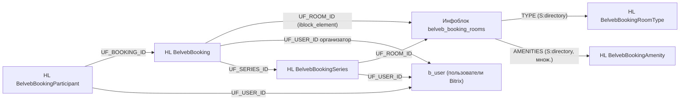

# Структура данных модуля бронирования

Хранение построено на штатных сущностях Bitrix, чтобы администрирование шло через готовые интерфейсы: переговорные — в инфоблоке, брони и справочники — в highload-блоках, сотрудники — в пользователях сайта. Структуру создаёт модуль `belveb.booking` в `installDB()`; MCP-сервер `bitrix-mcp-server` используется только для наполнения данными. Компоненты, которые работают с этими данными, — в [`components.md`](components.md).

## Схема связей



## Откуда взяты поля

| Макет | Данные на экране | Где хранится |
|-------|------------------|--------------|
| `410:546` список | «Переговорная 1», «Большой зал Правления», фото, Wifi / ВКС / Проектор / Экран / USB-C, «до 10 человек», «6 этаж»; фильтры Этаж, Тип переговорной | инфоблок комнат: `LABEL`, `NAME`, `PREVIEW_PICTURE`, `AMENITIES`, `CAPACITY`, `FLOOR`, `TYPE` |
| `866:343` детальная | шкала 08:00–19:00, слоты с темой и организатором, «Ваша бронь», «Обновлено в 10:00», границы 13:00–14:50 | `WORK_FROM` / `WORK_TO` / `SLOT_STEP` комнаты; `BelvebBooking` по комнате за день |
| `415:65` мои брони | «Забронировано», «6 человек», «14:00 – 15:30», «21.09.2026», «Евгений Меркулов»; «Завершена» / «Отменена»; «Повтор: ежедневно, от 04.09.2026»; участники списком | `BelvebBooking` + `BelvebBookingParticipant` + `BelvebBookingSeries` |
| `868:3483` подтверждение | Тема, Участники, Повтор, Комментарий | `UF_TITLE`, участники, серия, `UF_DESCRIPTION` |
| `1114:541` редактирование | «6/10» участников, «Изменений нет» | `CAPACITY` комнаты, `UF_UPDATED_AT` |
| `1114:923` повторное | «Данные перенесены из встречи 06.09.2026» | `UF_SOURCE_ID` |

## Инфоблок переговорных

| Параметр | Значение |
|----------|----------|
| Тип инфоблока | `belveb_booking` («Бронирование») |
| Код | `belveb_booking_rooms` |
| `API_CODE` | `bookingRooms` (нужен для D7 ORM `\Bitrix\Iblock\Elements\ElementBookingRoomsTable` и для MCP) |
| Название | «Переговорные» |
| Сайт | текущий `SITE_ID` |
| Разделы | не используются |
| Детальная страница | `#SITE_DIR#booking/#CODE#/` |

Переговорные — в инфоблоке, а не в HL-блоке, потому что нужны фото, сортировка перетаскиванием, активность и привычный редактор элемента для администратора.

### Стандартные поля

| Поле | Назначение |
|------|------------|
| `NAME` | Название: «Большой зал Правления» |
| `CODE` | ЧПУ детальной: `bolshoy-zal-pravleniya`; транслитерируется автоматически |
| `ACTIVE` | Комната доступна для бронирования |
| `SORT` | Порядок в списке |
| `PREVIEW_PICTURE` | Фото карточки (403×290 на макете) |
| `DETAIL_TEXT` | Описание комнаты; на макетах не показывается, зарезервировано |

### Свойства

| Код | Тип | Множ. | Обяз. | Назначение |
|-----|-----|-------|-------|------------|
| `LABEL` | строка `S` | нет | да | Подпись над названием: «Переговорная 1» |
| `FLOOR` | число `N` | нет | да | Этаж; фильтр «Этаж» |
| `CAPACITY` | число `N` | нет | да | Вместимость; текст «до 10 человек» и лимит участников |
| `TYPE` | `S:directory` → HL `BelvebBookingRoomType` | нет | да | Тип переговорной; фильтр «Тип переговорной» |
| `AMENITIES` | `S:directory` → HL `BelvebBookingAmenity` | да | нет | Оборудование; теги на карточке |
| `WORK_FROM` | строка `S` | нет | нет | Начало рабочего дня комнаты, `HH:MM`; пусто — из опции модуля |
| `WORK_TO` | строка `S` | нет | нет | Конец рабочего дня комнаты, `HH:MM`; пусто — из опции модуля |
| `SLOT_STEP` | число `N` | нет | нет | Шаг сетки в минутах; пусто — из опции модуля |

Шаг сетки по умолчанию — 10 минут: на макетах встречаются границы 14:50, 12:40 и 11:40. Рабочие часы по умолчанию — 08:00–20:00 (шкала на детальной начинается с 08:00 и уходит за 19:00).

Значения `S:directory` хранятся как `UF_XML_ID` записи справочника. Для фильтрации по типу и оборудованию используются `PROPERTY_TYPE` и `PROPERTY_AMENITIES` в ORM-запросах к инфоблоку.

## Highload-блоки

Имена таблиц с префиксом `belveb_booking_`. Все HL-блоки создаются из кода, UF-поля — через `\CUserTypeEntity`. Имя HL-блока (`NAME`) — ключ, по которому модуль находит блок на стенде.

### `BelvebBookingRoomType` — типы переговорных

Таблица `belveb_booking_room_type`. Справочник для свойства `TYPE`.

| Поле | Тип | Назначение |
|------|-----|------------|
| `UF_NAME` | string, обяз. | «Зал Правления», «Переговорная» |
| `UF_XML_ID` | string, обяз., уникальное | Внешний код: `board`, `meeting`; значение, которое хранит свойство инфоблока |
| `UF_SORT` | integer, по умолчанию 500 | Порядок в фильтре |

### `BelvebBookingAmenity` — оборудование

Таблица `belveb_booking_amenity`. Справочник для свойства `AMENITIES`.

| Поле | Тип | Назначение |
|------|-----|------------|
| `UF_NAME` | string, обяз. | «Wifi», «Система видеоконференцсвязи», «Проектор», «Экран», «USB-C» |
| `UF_XML_ID` | string, обяз., уникальное | `wifi`, `vcs`, `projector`, `screen`, `usb_c` |
| `UF_ICON` | file | SVG-иконка тега |
| `UF_SORT` | integer | Порядок тегов на карточке |

### `BelvebBooking` — брони

Таблица `belveb_booking`. Одна запись — один экземпляр встречи. Повторяющиеся встречи раскрываются в отдельные записи, чтобы проверка пересечений была одним запросом по комнате и диапазону дат.

| Поле | Тип | Обяз. | Назначение |
|------|-----|-------|------------|
| `UF_ROOM_ID` | iblock_element → `belveb_booking_rooms` | да | Комната |
| `UF_USER_ID` | integer | да | Организатор, ID из `b_user` |
| `UF_TITLE` | string | да | Тема встречи |
| `UF_DESCRIPTION` | string (text) | нет | Описание / комментарий |
| `UF_DATE_FROM` | datetime | да | Начало |
| `UF_DATE_TO` | datetime | да | Окончание |
| `UF_STATUS` | enumeration | да | `booked` (Забронировано), `completed` (Завершена), `cancelled` (Отменена) |
| `UF_SERIES_ID` | integer | нет | Серия повтора, если встреча повторяющаяся |
| `UF_SOURCE_ID` | integer | нет | Бронь, из которой сделано «Забронировать снова» |
| `UF_CREATED_AT` | datetime | да | Создана |
| `UF_UPDATED_AT` | datetime | нет | Последнее изменение; пусто означает «Изменений нет» |
| `UF_CANCELLED_AT` | datetime | нет | Когда отменена |
| `UF_CANCELLED_BY` | integer | нет | Кто отменил |

Правила:

- Активной считается запись `UF_STATUS = booked`. «Завершена» ставит агент `BookingCompleteAgent` для записей с `UF_DATE_TO` в прошлом.
- Пересечение: для комнаты `UF_ROOM_ID` не существует другой записи `booked` с `UF_DATE_FROM < новое UF_DATE_TO AND UF_DATE_TO > новое UF_DATE_FROM`. Проверка — в `AvailabilityService`, одним запросом.
- Количество участников ≤ `CAPACITY` комнаты (организатор считается участником).

Индексы — SQL в `install/db/mysql/install.sql`, так как интерфейс HL-блоков индексов не создаёт:

```sql
CREATE INDEX ix_belveb_booking_room_period ON belveb_booking (UF_ROOM_ID, UF_DATE_FROM, UF_DATE_TO);
CREATE INDEX ix_belveb_booking_user_from ON belveb_booking (UF_USER_ID, UF_DATE_FROM);
CREATE INDEX ix_belveb_booking_series ON belveb_booking (UF_SERIES_ID);
```

### `BelvebBookingSeries` — серии повторов

Таблица `belveb_booking_series`. Правило, по которому раскрываются экземпляры. Строка «Повтор: ежедневно, от 04.09.2026» на макете `415:65` берётся отсюда.

| Поле | Тип | Обяз. | Назначение |
|------|-----|-------|------------|
| `UF_ROOM_ID` | iblock_element | да | Комната |
| `UF_USER_ID` | integer | да | Организатор |
| `UF_RULE` | enumeration | да | `daily`, `weekly`, `monthly` |
| `UF_DATE_START` | date | да | Первая дата серии |
| `UF_DATE_END` | date | нет | Последняя дата; пусто — без ограничения, горизонт продлевает агент |
| `UF_TIME_FROM` | string `HH:MM` | да | Время начала каждого экземпляра |
| `UF_TIME_TO` | string `HH:MM` | да | Время окончания |
| `UF_ACTIVE` | boolean | да | Серия отменена целиком, если `N` |
| `UF_EXPANDED_TO` | date | нет | До какой даты экземпляры уже созданы |

### `BelvebBookingParticipant` — участники

Таблица `belveb_booking_participant`. Отдельная таблица вместо множественного поля `UF_PARTICIPANTS` в брони: множественные UF в HL-блоках сериализуются и не фильтруются, а «Мои бронирования» должны включать встречи, где пользователь участник, а не организатор.

| Поле | Тип | Обяз. | Назначение |
|------|-----|-------|------------|
| `UF_BOOKING_ID` | integer | да | Бронь |
| `UF_USER_ID` | integer | да | Участник |
| `UF_NOTIFIED_AT` | datetime | нет | Когда отправлено уведомление |

Индекс: `UNIQUE (UF_BOOKING_ID, UF_USER_ID)`, дополнительно `(UF_USER_ID)`.

## Пользователи

Организатор и участники — записи `b_user`. В редакции «Стандарт» нет типа поля `employee`, поэтому ссылки хранятся как `integer`. ФИО, фото и поиск — через `\Bitrix\Main\UserTable` (`NAME`, `LAST_NAME`, `SECOND_NAME`, `WORK_POSITION`). Для отображения «Ковалёв А.» используется формат «Фамилия И.».

Права:

- Создавать бронь может любой авторизованный пользователь.
- Изменять и отменять — организатор или член группы администраторов модуля (ID группы в опции `admin_group_id`).
- Администратор видит и отменяет любые брони в таблице «Бронирования на дату».

## Создание структуры: `installDB()`

Порядок важен: справочники нужны до свойств инфоблока, инфоблок — до HL-блока броней.

1. Тип инфоблока `belveb_booking` (`\CIBlockType::Add`).
2. HL-блоки `BelvebBookingRoomType` и `BelvebBookingAmenity` с полями (`\Bitrix\Highloadblock\HighloadBlockTable::add`, `\CUserTypeEntity::Add` с `ENTITY_ID = HLBLOCK_<id>`).
3. Инфоблок `belveb_booking_rooms` с `API_CODE = bookingRooms` и права `R` для всех, `W` для администраторов.
4. Свойства инфоблока, включая `TYPE` и `AMENITIES` с `USER_TYPE = directory` и `USER_TYPE_SETTINGS = ['TABLE_NAME' => ...]`.
5. HL-блоки `BelvebBooking`, `BelvebBookingSeries`, `BelvebBookingParticipant` с полями; enumeration-значения `UF_STATUS` и `UF_RULE` создаются вместе с полем.
6. Индексы из `install/db/mysql/install.sql`.
7. Почтовые события `BELVEB_BOOKING_CREATED`, `BELVEB_BOOKING_UPDATED`, `BELVEB_BOOKING_CANCELLED` с шаблонами по умолчанию.
8. Агенты `\Belveb\Booking\Agent\CompleteBookingsAgent::run()` (раз в 10 минут) и `\Belveb\Booking\Agent\ExpandSeriesAgent::run()` (раз в сутки).

`installDB()` идемпотентен: перед каждым шагом проверяется наличие сущности по `API_CODE` инфоблока, `NAME` HL-блока, `FIELD_NAME` поля, `EVENT_NAME` события. Повторный запуск установки на стенде с данными ничего не ломает.

`unInstallDB()` снимает всё в обратном порядке: агенты, почтовые события, HL-блоки (вместе с таблицами и UF-полями), инфоблок, тип инфоблока. Удаление данных пользователь подтверждает в стандартном диалоге деинсталляции (`savedata`); при сохранении данных HL-блоки и инфоблок остаются.

Код создания — в `lib/Install/` (`IblockInstaller`, `HighloadInstaller`), `install/index.php` их только вызывает.

## Как код находит сущности

ID инфоблока и HL-блоков на разных стендах различаются, поэтому код не хранит их ни в константах, ни в `.env`:

- инфоблок — по `API_CODE` через `\Bitrix\Iblock\IblockTable`, результат кешируется;
- HL-блок — по `NAME` через `HighloadBlockTable::getList`, ORM-класс компилируется `HighloadBlockTable::compileEntity`;
- доступ к ним — через `lib/Entity/` (`RoomTable`-обёртка, `BookingTable`, `SeriesTable`, `ParticipantTable`, `RoomTypeTable`, `AmenityTable`), остальной код модуля не знает про ID.

## Опции модуля

| Опция | По умолчанию | Назначение |
|-------|--------------|------------|
| `slot_step` | 10 | Шаг сетки в минутах, если у комнаты не задан `SLOT_STEP` |
| `work_from` / `work_to` | 08:00 / 20:00 | Рабочие часы по умолчанию |
| `horizon_days` | 90 | Как далеко вперёд можно бронировать и раскрывать серии |
| `max_duration` | 480 | Максимальная длительность одной брони в минутах |
| `min_duration` | 30 | Минимальная длительность |
| `cancel_before` | 0 | За сколько минут до начала ещё можно отменить; 0 — без ограничения |
| `admin_group_id` | группа администраторов сайта | Кто управляет чужими бронями |

## Наполнение через MCP

После установки модуля на стенде belvebcorp в `config.php` MCP-сервера `bitrix-mcp-server` добавляются ID созданных сущностей в `allowed_iblocks` и `allowed_hlblocks`. Порядок наполнения:

1. `hlblock_record_add` в `BelvebBookingRoomType`: `board` «Зал Правления», `meeting` «Переговорная».
2. `hlblock_record_add` в `BelvebBookingAmenity`: `wifi`, `vcs`, `projector`, `screen`, `usb_c`. Файл `UF_ICON` через MCP не загружается — иконки добавляются в админке или `installDB()` подкладывает их из `install/images/`.
3. `iblock_element_add` четырёх комнат с макета:

| `LABEL` | `NAME` | `FLOOR` | `CAPACITY` | `TYPE` | `AMENITIES` |
|---------|--------|---------|------------|--------|-------------|
| Переговорная 1 | Большой зал Правления | 6 | 10 | `board` | все пять |
| Переговорная 2 | Малый зал Правления | 6 | 4 | `board` | все пять |
| Переговорная 3 | Большой зал | 5 | 10 | `meeting` | все пять |
| Переговорная 4 | Малый зал | 5 | 4 | `meeting` | все пять |

Для свойств `S:directory` в `properties_json` передаётся `UF_XML_ID` записи справочника. `PREVIEW_PICTURE` через MCP не передаётся (файловые свойства не поддерживаются) — фото загружаются в админке.

Брони, серии и участники через MCP не создаются: их пишет только `BookingService`, чтобы не обойти проверку пересечений.

## Открытые вопросы

Не блокируют создание структуры, но влияют на `SeriesService` и `ReportService`.

1. Повтор «Ежедневно»: учитывать ли выходные и праздники. Предложение: `daily` раскрывается только по рабочим дням, календарь выходных — из опции модуля.
2. Горизонт раскрытия серии. Предложение: `horizon_days` (90 дней), агент `ExpandSeriesAgent` дораскрывает ежедневно.
3. Поведение при конфликте внутри серии: пропускать занятый день или отказывать во всей серии. Предложение: отказывать и показывать список конфликтных дат.
4. Формат «Скачать отчет». Предложение: CSV с колонками комната, дата, время, тема, организатор, участники, статус.
5. Бронь «в прошлое» и отмена перед началом: запрещать ли, и за сколько минут (опции `cancel_before`).
